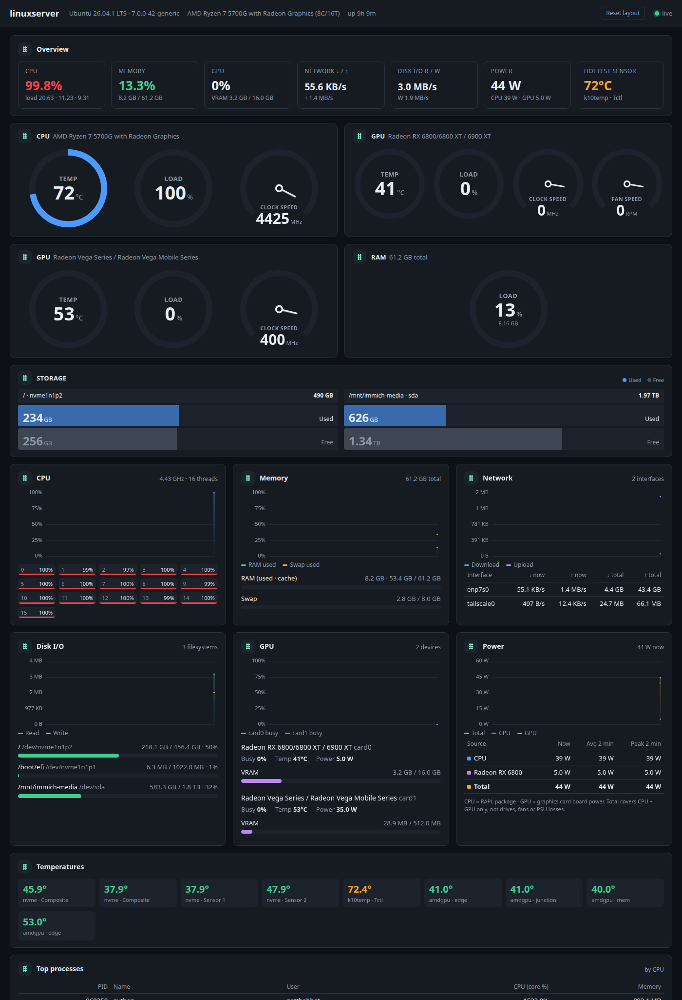

# System Monitor

A lightweight, real-time hardware monitor for a Linux server, served as a web page.
One small Python process samples the machine once per second and streams the data to
the browser over Server-Sent Events, with no database, no build step and no front-end framework.



## What it shows

- **Overview**: CPU, memory, GPU, network, disk I/O, power and hottest sensor at a glance
- **Gauges**: temperature and load rings plus clock and fan speed dials for the CPU and each GPU, and a RAM load ring
- **Storage**: used and free space per drive
- **Live charts (last 2 minutes)**: CPU (with per-thread bars), memory and swap, network per interface, disk I/O, GPU busy, and power
- **Power**: CPU package and GPU board power, the total, and the 2-minute average and peak
- **Temperatures**: every sensor `lm-sensors` / hwmon exposes
- **Top processes**: by CPU usage

Each section can be **dragged to a new position** with its grip handle, which appears on hover.
The arrow keys also move a focused grip. The layout is saved per browser, and **Reset layout** restores the default order.

## Requirements

- Linux with Python 3.9+
- [`psutil`](https://pypi.org/project/psutil/) (`sudo apt install python3-psutil` or `pip install psutil`)
- Optional: `lspci` (from `pciutils`) for friendly GPU names

GPU metrics (load, VRAM, clock, fan, power) are read from the `amdgpu` sysfs interface.
Other GPUs still appear in the temperature list if they expose hwmon sensors.

## Run

```bash
python3 server.py
# open http://<server-ip>:4400/
```

| Environment variable | Default   | Meaning                          |
|----------------------|-----------|----------------------------------|
| `MONITOR_PORT`       | `4400`    | HTTP port                        |
| `MONITOR_BIND`       | `0.0.0.0` | Address to listen on             |
| `MONITOR_INTERVAL`   | `1.0`     | Seconds between samples          |

## Run at boot (systemd user service)

```bash
mkdir -p ~/.config/systemd/user
cp server-monitor.service ~/.config/systemd/user/
systemctl --user daemon-reload
systemctl --user enable --now server-monitor
sudo loginctl enable-linger $USER   # keep it running when you are logged out
```

The unit expects the code at `~/server-monitor`. Edit `WorkingDirectory`/`ExecStart` if you cloned it elsewhere.

## Power readings

- **CPU**: RAPL package energy (`/sys/class/powercap/intel-rapl:0/energy_uj`) when readable,
  otherwise the AMD APU's PPT sensor (which covers the CPU and the integrated GPU).
  Since kernel 5.10, only root can read RAPL by default. To allow the monitor to use it:
  `sudo chmod o+r /sys/class/powercap/intel-rapl:0/energy_uj` (resets on reboot).
- **GPU**: discrete card board power from `amdgpu` hwmon.
- **Total** = CPU + discrete GPU. It does not include drives, fans or PSU losses.

## Security note

There is no authentication. The page exposes hardware details and the top-process list to
anyone who can reach the port. Bind it to a private interface (for example a Tailscale IP via
`MONITOR_BIND`) or put it behind a reverse proxy with auth if the network is not trusted.

## API

| Endpoint        | Description                                  |
|-----------------|----------------------------------------------|
| `/api/info`     | Static host info (hostname, OS, CPU model…)  |
| `/api/snapshot` | Latest sample as JSON                        |
| `/api/stream`   | Server-Sent Events stream, one sample/second |
